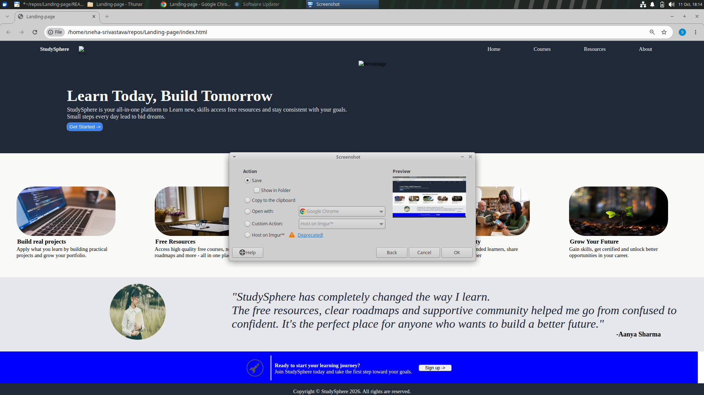

# Landing-page
This is a flexbox landing page project buit as a part of **The Odin Project** foundantions course. The goal of the project was to replicate a provided design mockup using pure HTML and CSS.

## Live Demo
You can view the live deployment of this website here:
https://github.com/snehasrivastava1978-hub/Landing-page

## Built with
* **HTML5** - Semantic structure
* **CSS3** - Flexbox layout and styling
* **Git & GitHub** - Version control and deployment

## Screenshot

## What I learned
* How to use CSS **Flexbox** for layout positioning.
* Structuring multi-section web pages ( Hero section, information cards, quote section and call-to-action ).
* Applying custom fonts, colors, and box models according to design specifications.

## Image Credits
* Here are the credits for the free-to-use images utilized in this layout:*
* Jothamsutharson
* StockSnap
* AnnieSprat
* Geralt
* Giovannaorlando
* Kodl68
* Pexels
* Surwise studio
* janjf93

---
*Created as part of my web development journey with The Odin Project.*